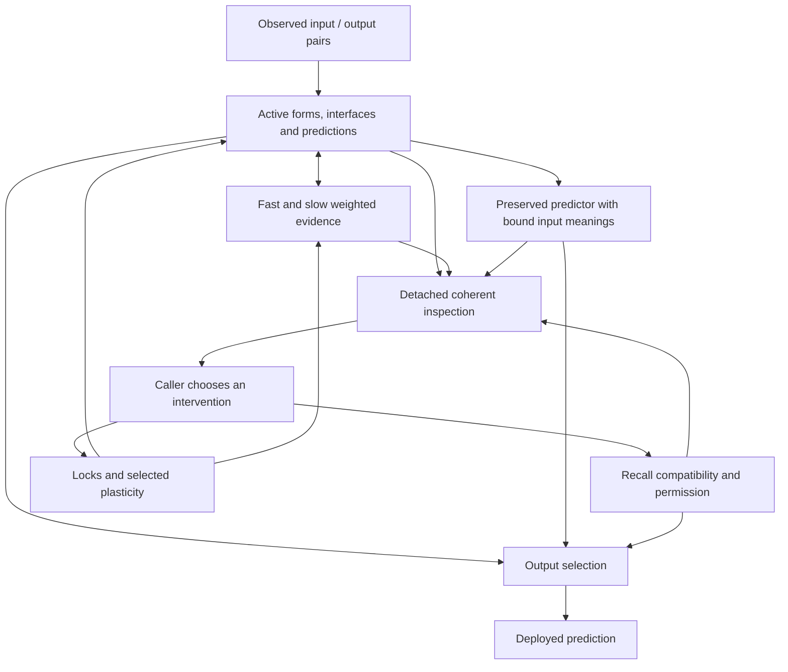

# Consolidated memory, inspection and steering API (038)

`ControlledLearner` is an optional composition wrapper over the frozen schema-37
path. It makes one tested configuration accessible without changing native
learning or promoting an automatic controller. The original `ContinuingLearner`
and its reference default remain unchanged.

## Responsibilities



Inspection does not select an intervention. The caller supplies commands, review
evidence and timing. The optional evidence-withdrawal rule is a fixed controller;
its thresholds and policy are not learned. The diagram describes responsibilities
within one implementation, not additional learners or a new cognitive theory.

## Configuration and use

```python
from advaita.controlled import ControlledLearner

# acquired is an acquired StructuralLearner. It is cloned, not mutated.
learner = ControlledLearner(acquired, recall_policy="command")
prediction = learner.observe(1, {
    "x": [0, 2], "a": 1, "local": [0, 1], "y": 0,
})
decision = learner.review(1, fresh_selection_rows)
view = learner.inspect()
event = learner.configure(
    lock=[0], plastic=[2], reason="Protect local form; adapt its relationship",
    source="operator",
)
learner.set_recall_block(True, reason="Review recalled output", source="operator")
restored = ControlledLearner.restore(learner.checkpoint())
assert restored.checkpoint() == learner.checkpoint()
```

This example demonstrates command syntax, not recommended timing or a beneficial
policy. Commands should be evaluated against relevant outcomes.

All configurations use `combined` weighted memory: relaxed evidence admission
plus selective slow weakening, with coherent post-review refits. `recall_policy`
is fixed at construction:

| Choice | Behaviour |
| --- | --- |
| `shadow` (wrapper default) | Preserve and score a predictor but never deploy it. |
| `command` | Ordinary fresh recall admission; allow explicit block/release. |
| `current` | Same engine behaviour as command; retained as a saved-study comparator. |
| `evidence` | Ordinary admission plus the tested 16-observation withdrawal rule. |

Explicit block/release is accepted in each mode; releasing shadow mode cannot
enable recall. Native snapshots and admission policies remain experimental.

## State and timing contract

An observation advances a consecutive integer clock, decays evidence, refits,
predicts before seeing its label, adds the label and refits again. Withdrawal
monitoring then assesses that completed prediction. A withdrawal affects the
next prediction, never the prediction whose label triggered it. A missing row
still advances time and decay but produces no prediction.

A review requires a current labelled tick and a nonempty validated batch, once
per tick. It evaluates the preserved and active predictors before its structural
changes, then runs native structural selection, weakening, migration and coherent
refitting. Archive confirmation/admission and external block precedence follow.
Review outcomes and pending decisions may describe intermediate states; the
snapshot's `learning.locals` and `learning.upper` describe the coherent current
state. Selection batch independence remains the caller's responsibility; content
validation does not establish evidence independence.

The inherited memory schedule remains deliberately visible: capture at tick384,
confirm at448 and512, admit from576. The inherited weakening corroboration expects
reviews64 ticks apart. The caller must supply those reviews to exercise the
tested lifecycle. Missing capture/confirmation opportunities can leave recall
unavailable. We have not replaced these supplied timings with a general scheduler.

## Commands and scope

`configure(lock=..., plastic=..., reason=..., source=...)` replaces the full
configuration after a current completed review, once per review. Locks target
local channels0/1; plasticity can target0/1/2. Lock and plastic lists must be
distinct and disjoint. Locks hold partitions, not probability estimates or group
label ordering. Plasticity changes selected slow half-lives1024→128; fast remains64.
`configure(lock=[], plastic=[], ...)` releases these controls. It does not restore
old evidence, predictions or history.

`set_recall_block(bool, reason=..., source=...)` requires a completed labelled
observation, once per tick. A block overrides later admission. Both block and
release clear current authorization and the partial monitoring window. Release
permits fresh admission at a subsequent review; it never reinstates an old route.
The order of separate commands and reviews is observable and retained. A command
does not schedule its own later release.

Events contain reason/source, operation, tick, native before/after hashes and the
native event. Supported validation errors are rejected before mutation. These
records support review and replay; they are not secure isolation or proof that
an intervention is beneficial.

## Inspection and prediction

`inspect()` returns detached learning state, active/archived input meanings,
fast/slow evidence masses, archive, permission, partial monitoring, pending
decisions, native costs, review and command history. `last_prediction` gives the
pre-label active and deployed probabilities and their actual source.
`current_output_source` reports what the current state permits now. These can
differ immediately after withdrawal or review. A missing observation clears
`last_prediction` rather than mislabelling a previous one as current.

`predict(x, action)` returns current active/deployed probabilities and source
without advancing time, decay, refitting, training or updating native counters.
It is a diagnostic query; its result need not equal a subsequent observation's
prediction after decay. Repeated inspection or diagnostic queries must not change
future learning. Native costs omit wrapper copying/serialization and diagnostic
queries; do not interpret them as total wall-clock or memory consumption.

`checkpoint()` stores schema38, complete native schema37 state and wrapper
metadata. `restore()` continues that state including controls and partial monitor
windows. `native_checkpoint()` exposes exact legacy bytes for comparison. Restoring
our own trusted checkpoints is supported; malicious file validation and direct
internal-object tampering are outside this API's contract.

## Deliberate exclusions and evidence

This wrapper does not add the earlier explicit one-shot evidence-halving command,
temporary-plasticity closure heuristic, arbitrary relation editing, upper locks,
multiple archive slots or a policy switch during a trajectory. Automatic
selective weakening already belongs to its unchanged native engine. The original
archive engine and alternative weighted-memory modes remain accessible through
their earlier APIs, without implying all combinations are supported here.

Compatibility verification follows the [038 protocol](../experiments/control_consolidation_protocol.md).
The [first steering synthesis](../results/steering-round-one-synthesis.md) remains
the evidence for usefulness and its limits. Exact replay demonstrates preservation
of that evidence, including its failures. It does not turn the combined interface
into a generally reliable controller, establish human/LLM comprehension, or provide
new evidence of safety or meta-learning.
