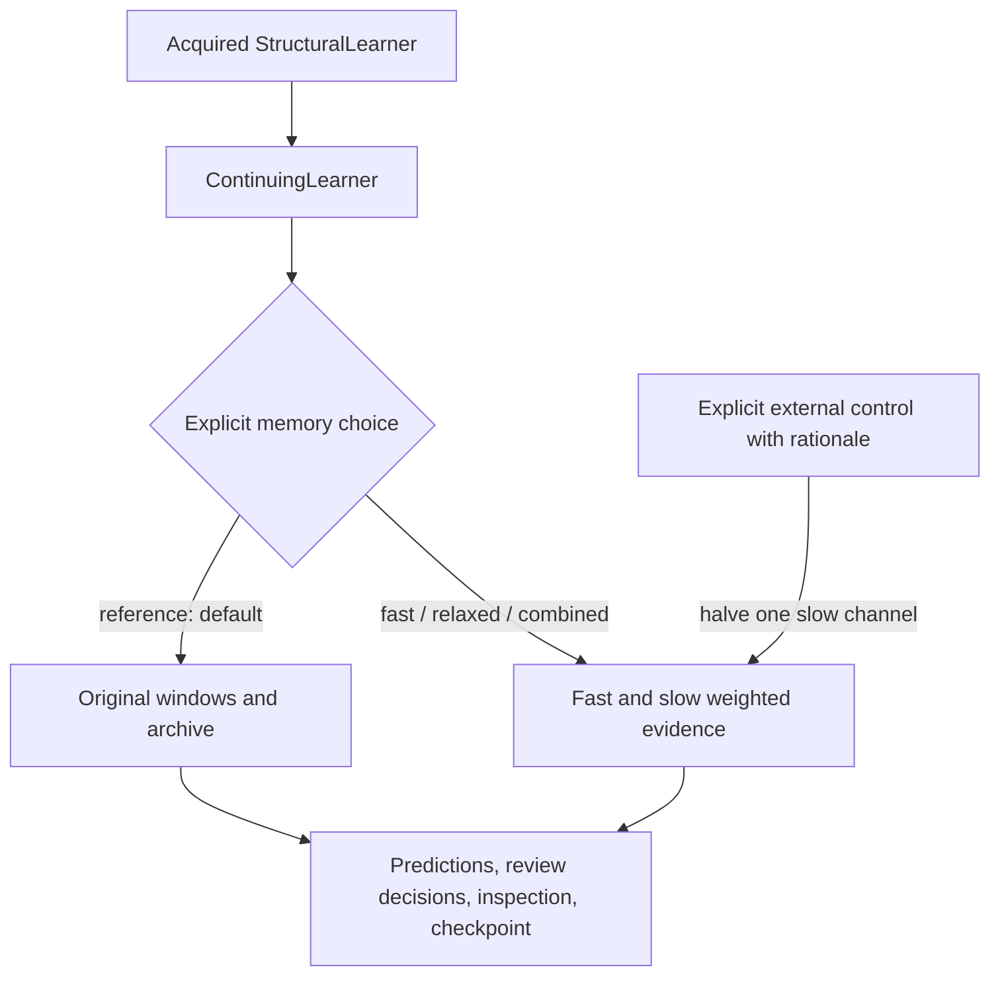

# Continuing learner with optional memory control

Added 2026-11-02. The original integrated learner remains the default. The
weighted-memory variant is an explicit choice, with its existing tradeoffs.



This is integration around frozen engines. It does not combine the original
archive and the weighted slow store into a new algorithm. The 029 compatibility
check reproduced every prediction, review and native final checkpoint from all
350 saved 028 runs, including a midway restart.

## Use

Acquire local models and the upper model through the existing StructuralLearner
API. Then pass that acquired instance to the continuing API. The instance is
cloned, so construction does not alter the supplied learner.

```python
from advaita.continuing import ContinuingLearner

reference = ContinuingLearner(acquired)  # Original reference, by default.
learner = ContinuingLearner(acquired, memory="combined")

# Three pre-update probabilities: local0, local1, composite.
prediction = learner.observe(1, {"x": [0, 2], "a": 1,
                                  "local": [0, 1], "y": 0})
# Or advance elapsed time without an observation:
learner.observe(2, None)

view = learner.inspect()               # A copy; editing it cannot alter state.
saved = learner.checkpoint()           # Outer metadata and native engine state.
restored = ContinuingLearner.restore(saved)
```

Ticks must be consecutive. A review must use the current labelled tick, occur
once for that tick, and contain a nonempty batch. `review(tick, rows)` returns the
engine's complete structural and memory decisions. Supply fresh selection rows;
the API detects repeated review ticks, not duplicated observations disguised as
new rows. It does not infer record identity from content. Within one review the
same labels intentionally support structure, weakening and migration decisions.

Inspection includes current forms, upper interface, evidence masses (for the
weighted variants), the latest review, control events and native engine costs.
Native cost layouts differ across engines; this is not a normalized cost API.
The experiment reports aggregate those costs explicitly.

Supported memory choices are `reference`, `fast`, `selective`, `relaxed`,
`weaken`, `combined`, and `uniform`. Their definitions remain those of 027–028.
No method changes or learns the memory-control parameters. The wrapper has no
simulator, evaluation truth, change signal or task-history label.

## One bounded intervention

After inspecting a completed current review, a caller can explicitly discount
one slow evidence channel:

```python
# After a labelled observation and learner.review(tick, fresh_rows):
event = learner.weaken_slow(
    2, review_tick=tick,
    reason="Current review shows a stale composite prediction")
```

Channel0/1 refers to local evidence; channel2 to composite evidence. The operation
halves that entire slow channel, leaves fast evidence unchanged, clears its
pending structural and weakening decisions, and refits active predictions.
It records the current review tick, rationale, removed mass and before/after
native-state hashes. The effect of a local change may propagate through an upper
interface using that local meaning; it is not guaranteed to stay behaviorally
local. At most one explicit operation per channel per review is accepted.

This operation is unavailable on the original reference, which has no weighted
slow store. There is no protection/freeze operator in this minimal API. It is
an inspectable mechanism for experiments, not secure isolation or evidence of
human/LLM interpretability. Callers must choose and evaluate interventions.
The 031 study uses a scripted diagnostic; it does not simulate a human user.

`checkpoint()` preserves native state plus clock, reviews and control history.
`learning_checkpoint()` exposes the native engine serialization for exact
compatibility and independent replay. Raw sufficient statistics remain retained
behind coarse interfaces. Inspection/log metadata is not an additional training
buffer. Logs and evidence identities are audit affordances, not a safety proof.

Evidence: [integration](../results/memory-integration-v1/findings.md),
[lifecycle tests](../results/memory-lifecycle-v1/findings.md), and
[steering protocol](../experiments/memory_steering_protocol.md).

The subsequent [032 inspection test](../results/introspection-v1/findings.md)
found that upper prediction tables can remain stale after a local form changes
during review. A later refit, including one inside an explicit control, can
refresh them. Inspection faithfully reports stored state but does not certify
post-review consistency. See [the inspection contract and limitations](introspection.md).
