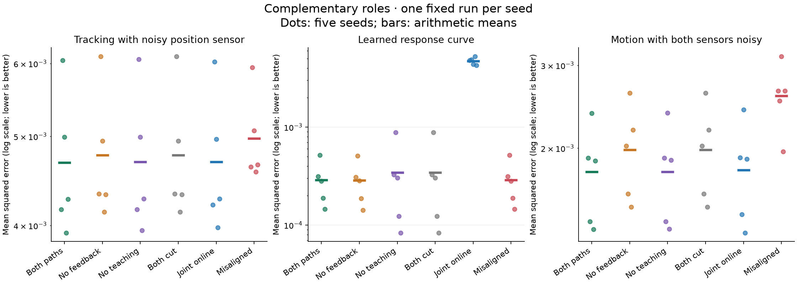
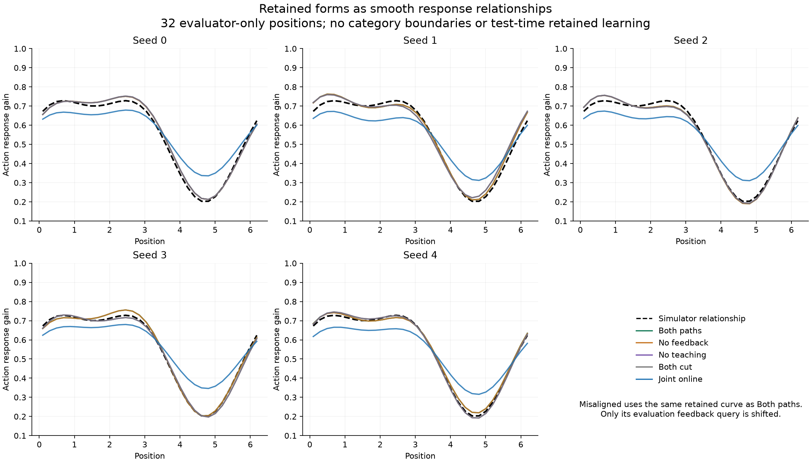

# Experiment 007: learned relationships help, reciprocal complementarity unestablished

Completed 2026-10-15. The proposed learner acquired an accurate smooth response
relationship, and using that relationship improved motion prediction relative
to withholding predictive feedback. However, the **predeclared complementarity
criterion failed**. Situated estimates did not consistently improve retained
learning, and the full loop performed almost identically to the condition
learning its retained relationship from raw position observations.

This is evidence of a useful learned relationship in this constructed task,
with an observed benefit from using it. It is not a successful demonstration
that the two proposed roles robustly compensate for each other's limitations.

[Fixed protocol](../../experiments/complementary_roles_protocol.md) ·
[Design and equations](../../experiments/complementary_roles_design.md) ·
[All seeds, sensor regimes and costs](report.md) · [Metrics](metrics.json) ·
[Full trace and provenance](results.json)

## What the learner encountered

Actions moved a probe along a continuous track with a smoothly varying response
gain. There were no category labels or region boundaries. Position and motion
were observed through separate noisy sensors. The learner never received true
position or the true response function as training information.

The fast process estimated current position and adapted a temporary local gain
correction. The retained process fitted a five-coefficient smooth response
curve. Two connections could be cut independently: estimated states teaching
the retained curve, and the retained curve supplying predictive feedback to the
position observer. Even with feedback cut, the fast process kept a constant
gain prior and local adaptation. All conditions received identical world data.

This is a test of learning and using a continuous form within a supplied basis.
The Fourier basis can express the simulator's relationship; its coefficients
were learned. The experiment does not demonstrate discovery of that basis,
category creation, autonomous exploration, or general causal explanation.

## The registered test failed

Each directional/joint condition required a 10% reduction in the specified
error in at least four of five seeds and in the pooled mean. The guard required
no more than 5% pooled degradation in the clean-sensor condition.

| Required contribution | Observed reduction in pooled error | Seeds passing | Result |
| --- | ---: | ---: | --- |
| Learned feedback improves tracking with noisy position observations | 1.84% | 0/5 | Failed |
| Situated estimates improve the retained response curve | 15.83% | 1/5 | Failed consistency requirement |
| Both paths improve noisy-motion prediction relative to each one-path cut | 10.33% vs no feedback; 0.086% vs no teaching | 0/5 | Failed |
| Clean-sensor motion error stays within the declared guard | Improved relative to both paths cut | Pooled check | Passed |

No seed passed all three directional/joint conditions. The thresholds were not
relaxed after seeing results. The pooled improvement in retained-curve error
conceals seed variation and cannot replace the required consistency check.

In particular, state teaching reduced retained-curve error by about 4%, 41%,
and 7% in seeds 0–2, but increased it by about 52% and 75% in seeds 3–4. Those
large relative increases are on small absolute errors; all the batch-fitted
curves approximated the response relationship well. The full loop's pooled
curve error was slightly higher than when predictive feedback was cut
(0.000289 versus 0.000286), so stronger reciprocity did not reliably improve
the retained relationship.

## What worked, and what the controls show

All values below are mean squared errors, averaged over the five seeds.

| Condition | Position error, all regimes | Motion error, all regimes | Retained-curve error |
| --- | ---: | ---: | ---: |
| Both paths connected | 0.00237101 | 0.00093115 | 0.00028906 |
| Predictive feedback cut | 0.00243195 | 0.00110838 | 0.00028630 |
| State teaching cut | 0.00237478 | 0.00093119 | 0.00034342 |
| Both paths cut | 0.00243195 | 0.00110838 | 0.00034342 |
| Joint online learner | 0.00237870 | 0.00094998 | 0.00470358 |
| Misaligned evaluation feedback | 0.00257890 | 0.00159122 | 0.00028906 |

The initial constant response curve had error 0.03625. The full model's final
curve error was about 99.2% lower. Thus the failure of the complementarity test
is not a failure to learn the response relationship at all.

Using learned feedback reduced pooled motion error by about **16%** compared
with the same teaching arrangement without feedback. That secondary comparison
improved in all five seeds. But when state teaching was cut, the retained curve
could still be learned from raw observations and motion prediction was almost
unchanged. The data therefore support a useful prediction mechanism more
strongly than a need for reciprocal teaching in this task.

The joint online learner had about 2% higher pooled motion error than the full
model, despite a substantially less accurate retained curve. Its curve-only
motion error was 0.00102041, compared with its deployed error of 0.00094998.
Local adaptation can help current performance even with a less accurate retained
relationship; good current prediction should not be treated as sufficient
evidence of a well-extracted form. We did not separately ablate that correction.
The online comparison used one fixed learning rate, with no tuning, and does
not establish that batch fitting or two explicit roles outperform online
learning in general.

The misaligned control kept exactly the same retained curve and pre-evaluation
history as full, but queried the curve half a spatial period away during
evaluation. Its pooled motion error rose by about **71%**. Thus the content of
feedback mattered, rather than the mere presence of a channel. This deliberately
wrong-feedback comparison is not a substitute for the failed directional tests.





The batch-fitted curves largely overlap in the second figure. The misaligned
condition is not a separate curve: it uses the full model's curve at an incorrect
location in its observer. All plotted data are saved evaluator-only queries;
plotting did not train a model or run additional worlds.

## Interaction, selection, and limits of the task

The factorial interaction was mixed and small on deployed prediction metrics.
Its mean for motion MSE was about 4.85e-8; for retained-curve MSE it was negative
(-2.76e-6). There is no consistent substantial superadditive result here.
Superadditivity was a diagnostic, not a prerequisite for complementarity.

The full condition accepted 12 of 20 proposed retained updates across seeds.
Six rejected candidates worsened the selection-episode error; two failed the
minimum-improvement rule. This shows actual rejections on observed selection
evidence, unlike the all-accepted transfer experiment. It does not establish
that the gate improves generalisation: no no-selection ablation was run, and a
single selection episode can be an imperfect judge of a global curve.

Two limitations help define the next question, without changing this result:

- The world is smooth, the position sensor is directly informative, and the
  curve basis is well suited to its dynamics. Even raw contexts can teach a
  good response curve. This task may offer little need for the state-teaching
  connection; that is a design inference, not a demonstrated cause of failure.
- In the noisy-motion regime, independent process and motion-sensor noise
  contribute an expected irreducible MSE of 0.002^2+0.04^2=0.001604. The full
  HH error was 0.00178074. Comparisons on noisy observable targets can compress
  differences between already useful predictors. This is a consequence of the
  specified noise model, not a reason to lower the registered threshold.

The observer also always gives the current position measurement a fixed weight
of one half. We have not tested adaptive trust, sensory ambiguity that cannot
be resolved by averaging, or revising a stale retained form. Those are different
experiments, not additions made after this failure.

## Verification, resources, and stopping

All **nine synthetic correctness tests passed before execution**. The independent
saved-record audit passed afterwards without importing the learner implementation.
It regenerated every world stream and verified causal updates, path cuts,
normal equations, clipping, candidate isolation, selection, retained evaluation
freeze, costs, metrics, criteria, paired controls, budgets and source hashes.

There were exactly **23,040 transitions/motion outcomes and 23,040 position
measurements**: 30 runs, each with 480 main, 96 selection and 192 evaluation
transitions. These are six presentations of each of five paired world streams,
not 30 independent worlds. Final and initial-reference curves each used 960
evaluator-only queries. Latent position and gain never entered learner updates.

Each batch condition performed 20 fits and replayed 6,000 main rows across its
five seeds. Online performed 2,880 coefficient updates, including selection
observations. Thus observation allocation is matched but feedback use and
computation differ. The retained model stores five coefficients; the observer
adds current state and a temporary gain correction; main storage is capped at
480 records. All costs are reported in the full report.

Clipping was not absent: full and no-teaching each clipped the deployed gain
10 times across all stages/seeds; no-feedback and disconnected each clipped the
local correction 11 times. Misaligned evaluation caused 149 local-correction
clips. No retained gain query or coefficient hit its clipping limit. The joint
online model clipped its deployed gain six times. These constraints were
declared in advance and their effects remain part of the tested mechanisms.

Commands for the core checks and run:

```sh
python3 -m unittest discover -s checks -p 'test_complementary_roles.py' -v
python3 experiments/complementary_roles.py
python3 checks/audit_complementary_roles.py
```

The benchmark refuses to overwrite its existing result directory. Figures were
generated afterwards using matplotlib with the existing local plotting
dependencies. Both figures were visually checked. No benchmark rerun, tuning,
implementation correction after execution, or further experiment was needed.

This attempt stops here. It supports learning and using a smooth form, but
does not yet support the stronger claim of robust reciprocal complementarity.
The next design decision should address what one role genuinely cannot resolve
without the other, rather than increasing model size or declaring cooperation
from agreement alone.
