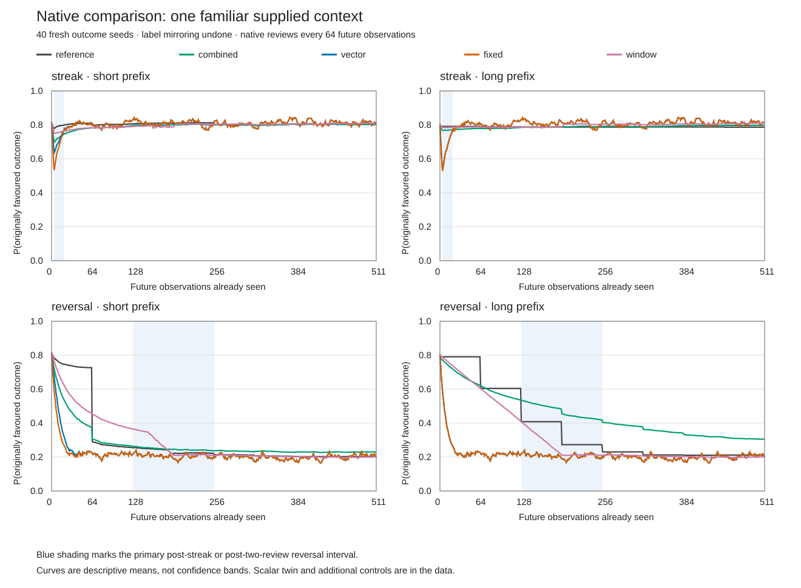

# Heaviside Stage 2 — native-context comparison

Completed 2026-11-13. **The native improvement criterion failed; the separate
fixed-gain attribution criterion passed.** All 240 prefixes and 720 native
future trajectories passed independent forecast, decision and learning-state
reconstruction. These yield 4,320 output records from 40 fresh outcome seeds.

This tests a contextual output intervention for one supplied familiar input.
It does not replace or improve the complete architecture by construction.

## What was compared

The [frozen protocol](../../experiments/heaviside_native_protocol.md) keeps the
ordinary native observation and review entry points: reference with its existing
archive-deleting variant, relaxed admission, and combined admission/weakening.
No native learning equations, review thresholds or proposal rules were changed.
Original native post-review inspection limitations remain; scoring uses the actual
pre-label probability returned by observation.

The same acquired state supplies one target context. Five optional readouts
(vector, scalar twin, fixed gain, window and fixed-prior counts) receive the same
main outcomes and override only that context's final probability. The address is
supplied raw input, not a newly learned category. Outside it, output remains native.
All native state evolves identically regardless of which readout is reported;
actions and future observations are exogenous. The numerical readouts also agree
across all three backbones because their inputs and initialization match.

Rho .9, gain .1 and the 192-observation window were fixed from Stage 1; there was
no further development or tuning. Short/long prefixes contain 10/1000 outcomes,
then each state branches into 512-observation stable, four-observation streak and
lasting-reversal futures. Label mirroring is a reversible input/output renaming,
not a rewrite of the acquired model. Prefixes and branches preserve pending state.

## Paired forecast effects

Candidate-minus-control Brier loss: negative is better for the named candidate.
Intervals are 95% percentile intervals from 10,000 paired seed-bootstrap samples,
averaging the two histories equally within each seed. Primary native success
requires post-streak upper bounds below zero and stable/reversal upper bounds
below +.01 against both reference and combined. Attribution additionally requires
the same comparison against fixed gain. `combined_vs_relaxed` tests the native
weakening mechanism rather than the contextual adapter.

| Candidate minus control | Stable 1–512 | Post-streak 5–20 | Reversal 129–256 |
| --- | ---: | ---: | ---: |
| vector_vs_reference | +0.007331 [+0.006676, +0.007956] | +0.020979 [+0.016145, +0.025811] | -0.005566 [-0.008652, -0.002571] |
| vector_vs_relaxed | +0.007270 [+0.006741, +0.007759] | +0.017776 [+0.014604, +0.020967] | -0.032213 [-0.036150, -0.028364] |
| vector_vs_combined | +0.007270 [+0.006741, +0.007759] | +0.017776 [+0.014604, +0.020967] | -0.028918 [-0.033263, -0.024827] |
| vector_vs_fixed | -0.000068 [-0.000074, -0.000062] | -0.007086 [-0.007607, -0.006553] | -0.000000 [-0.000000, +0.000000] |
| vector_vs_window | +0.007210 [+0.006608, +0.007737] | +0.022259 [+0.019078, +0.025447] | +0.002191 [+0.000076, +0.004233] |
| vector_vs_prior_selected | -0.000454 [-0.000639, -0.000279] | -0.006315 [-0.008112, -0.004593] | -0.000109 [-0.000545, +0.000341] |
| combined_vs_relaxed | +0.000000 [+0.000000, +0.000000] | +0.000000 [+0.000000, +0.000000] | -0.003294 [-0.004549, -0.002071] |

History-specific descriptive differences:

| Contrast | History | Stable | Post-streak | Late reversal |
| --- | --- | ---: | ---: | ---: |
| vector_vs_reference | short | +0.007422 | +0.010293 | +0.007263 |
| vector_vs_reference | long | +0.007240 | +0.031665 | -0.018394 |
| vector_vs_relaxed | short | +0.006979 | +0.005297 | +0.006345 |
| vector_vs_relaxed | long | +0.007560 | +0.030255 | -0.070771 |
| vector_vs_combined | short | +0.006979 | +0.005297 | +0.006345 |
| vector_vs_combined | long | +0.007560 | +0.030255 | -0.064182 |
| vector_vs_fixed | short | -0.000137 | -0.014172 | -0.000000 |
| vector_vs_fixed | long | -0.000000 | -0.000000 | -0.000000 |
| vector_vs_window | short | +0.007078 | +0.013022 | +0.002681 |
| vector_vs_window | long | +0.007341 | +0.031496 | +0.001700 |
| vector_vs_prior_selected | short | -0.000456 | -0.006019 | -0.000109 |
| vector_vs_prior_selected | long | -0.000453 | -0.006612 | -0.000109 |
| combined_vs_relaxed | short | +0.000000 | +0.000000 | +0.000000 |
| combined_vs_relaxed | long | +0.000000 | +0.000000 | -0.006589 |

## Did slow revision have a chance to act?

Reviews occur after future observations 64,128,...,512. The primary reversal
window129–256 follows two review opportunities, without resetting pending evidence
at the branch. Qualifying weakening is not forced. Accepted native changes were:

| History | Future | All accepted weakenings | Composite weakenings | First composite effect observation |
| --- | --- | ---: | ---: | ---: |
| short | stable | 0 | 0 | none |
| short | streak | 0 | 0 | none |
| short | reversal | 0 | 0 | none |
| long | stable | 0 | 0 | none |
| long | streak | 0 | 0 | none |
| long | reversal | 53 | 53 | 193 |

The first-effect column is the observation after the earliest accepted composite
weakening; it is not an estimated recovery time or a guarantee of benefit. Native
structural changes also continue. Consult the combined-versus-relaxed comparison
to distinguish the usefulness of selective weakening from an adapter advantage.

## Early cost, recovery and trajectories

| Output | History | Early reversal Brier | Capped recovery delay | Censored fraction |
| --- | --- | ---: | ---: | ---: |
| fixed | short | 0.203074 | 7.575 | 0.000 |
| reference | short | 0.483481 | 54.675 | 0.000 |
| vector | short | 0.216466 | 10.975 | 0.000 |
| window | short | 0.319683 | 48.150 | 0.000 |
| combined | short | 0.274280 | 28.250 | 0.000 |
| fixed | long | 0.203298 | 7.925 | 0.000 |
| reference | long | 0.506656 | 128.000 | 0.000 |
| vector | long | 0.203298 | 7.925 | 0.000 |
| window | long | 0.416704 | 99.725 | 0.000 |
| combined | long | 0.406047 | 167.700 | 0.000 |

Recovery means the first forecast starting four consecutive predictions on the
new side of .5, counted in observations already seen. Censored delays are capped
at512 for the mean, never presented as observed recoveries.

The vector/scalar maximum per-event difference was 5.55e-16,
below 1e-12. Equality checks the representation identity; it is not evidence for
an advantage of geometric coordinates.

## Evidence budgets, verification and boundaries

Every alternative is allocated the same main and independent review rows. Native
engines fit main observations and use review labels through their existing policies.
Adapter heads fit only main outcomes; review losses are recorded without fitting
or selection. Thus available evidence is matched, while evidence use differs.
Native engines also receive the two supplied local labels. The acquired snapshot
and initial 32 target-row outcomes are reused evidence, not fresh observations.

There were 489,840 native main-row updates and 249,600 review rows across physical
backbone replays, respectively 1,469,520 and 748,800 scalar-label presentations.
Five heads perform 2,449,200 numerical updates on those same main outcomes.
The 40 worlds contain 154,320 materialized composite-label entries; 123,760 distinct
constructed positions remain after accounting for shared stable/streak data.
These presentations and output alternatives are not independent statistical samples.

Three deterministic fixture tests checked routing, active-state parity, mirrored
labels, read-only head reviews, continuation and independent native references.
The runner checked 1,440 exact checkpoint round trips. The auditor separately
reconstructed forecasts, native review decisions, final learning state, metrics
and bootstrap intervals using the earlier independent reference implementations.
It does not independently rebuild all runtime ledger metadata. The runner took
402.258s; independent audit took 105.113s.

This is one acquired/proposal state and one fixed input context with 40 fresh
outcome streams. It does not test category transfer, context discovery, policy
learning, safe steering or general superiority. Any gain can include the effect
of an explicitly addressed output alternative; the matched fixed/window controls
are essential to interpreting that gain. Earlier native and Stage 1 results are
unchanged. No architecture default is promoted and no further test is automatic.

Artifacts: [summary](results.json), [audit](audit.json), [metrics](metrics.csv),
[worlds](worlds.json), [initial state](initial.json), [manifest](manifest.json),
[prefix traces](prefixes.jsonl.gz), [native and output traces](runs.jsonl.gz),
[standalone plot](mean-forecasts.svg).
