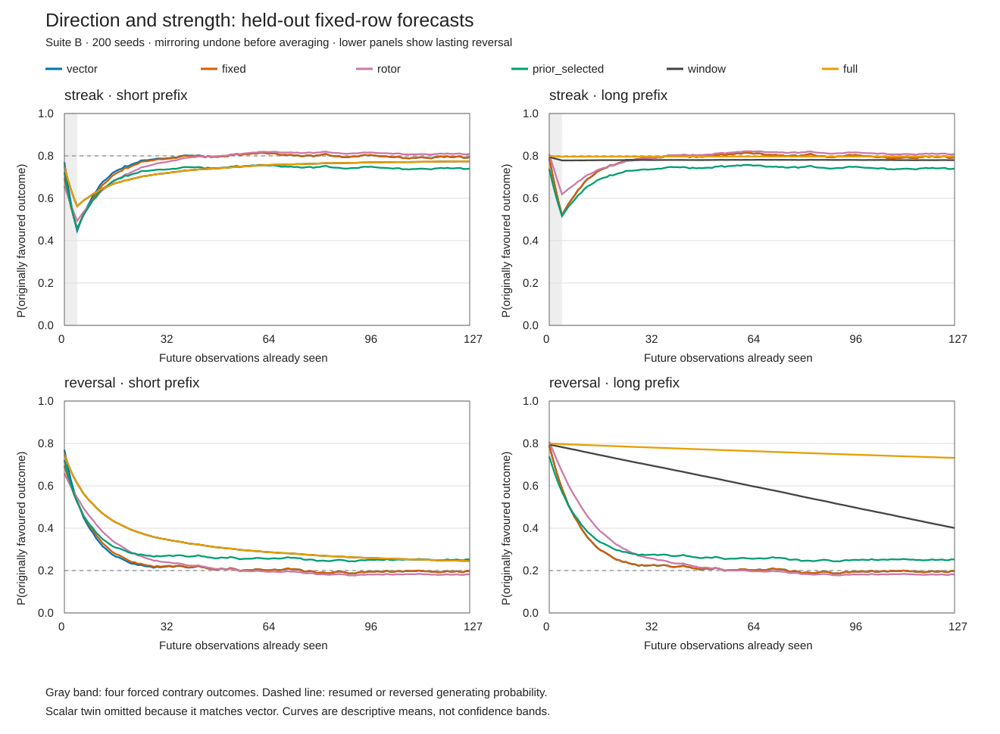

# Heaviside Stage 1 — isolated direction/strength comparison

Completed 2026-11-13. **The declared isolated-prediction trade-off criterion failed. A benefit from retained strength cannot be claimed from the primary comparison as a whole.** Independent reconstruction passed for all
2,304 development runs and 18,000 confirmation runs. No native-agent superiority
or architecture change is established by this fixed-row study.

## Design and selected settings

The [protocol](../../experiments/heaviside_prediction_protocol.md) was saved before
development. Seeds 0–31 selected parameters using suite B only; seeds 1000–1199
were used once for confirmation. Suite A imposes identical odds with short/long
support; suite B replays identical shuffled prefixes, whose final odds can differ
between algorithms. Confirmation streams are shared across arms and histories,
with half the seeds label-mirrored. No further tuning was performed.

Selected rho for vector/scalar: **0.9**; matched gain:
**0.10**; separately selected fixed gain: **0.1**;
rotor eta: **0.2**; separately selected fixed-prior rho:
**0.9**. Full retention uses rho 1; the rolling window holds 192
observations. The fixed-prior controls retain their unit priors and forecast after
elapsed-event discount. These are numerical controls, not the native review-based
learner or its selective-weakening policy.

## Held-out comparison

Values are **vector minus control Brier loss**: negative is better for vector.
The two histories receive equal weight within each seed. Intervals use 10,000
paired seed-bootstrap samples. Stable measures observations 1–128, post-streak 5–20,
and reversal 1–64. The primary gate requires post-streak upper bounds below 0 and
stable/reversal upper bounds below+.01 against **both window and fixed**.

| Control | Stable difference [95% interval] | Post-streak difference [95% interval] | Reversal difference [95% interval] |
| --- | ---: | ---: | ---: |
| full | +0.007460 [+0.006990, +0.007917] | +0.021423 [+0.019588, +0.023135] | -0.160992 [-0.165452, -0.156587] |
| fixed | -0.000089 [-0.000142, -0.000037] | -0.000672 [-0.000841, -0.000506] | +0.001166 [+0.001103, +0.001229] |
| matched | -0.000089 [-0.000142, -0.000037] | -0.000672 [-0.000841, -0.000506] | +0.001166 [+0.001103, +0.001229] |
| rotor | +0.002849 [+0.002654, +0.003045] | +0.006672 [+0.005933, +0.007403] | -0.005905 [-0.006403, -0.005402] |
| prior_matched | -0.000258 [-0.000463, -0.000050] | -0.005067 [-0.005923, -0.004215] | +0.000673 [+0.000319, +0.001029] |
| prior_selected | -0.000258 [-0.000463, -0.000050] | -0.005067 [-0.005923, -0.004215] | +0.000673 [+0.000319, +0.001029] |
| window | +0.007103 [+0.006621, +0.007572] | +0.020837 [+0.019061, +0.022522] | -0.117938 [-0.121614, -0.114268] |

History-specific differences below are descriptive, without separate confidence
claims. Equal pooled weights must not conceal opposing short/long effects.

| Control | History | Stable | Post-streak | Reversal |
| --- | --- | ---: | ---: | ---: |
| full | short | +0.006416 | +0.009876 | -0.021700 |
| full | long | +0.008504 | +0.032970 | -0.300285 |
| fixed | short | -0.000178 | -0.001344 | +0.002332 |
| fixed | long | -0.000000 | -0.000000 | +0.000000 |
| matched | short | -0.000178 | -0.001344 | +0.002332 |
| matched | long | +0.000000 | -0.000000 | -0.000000 |
| rotor | short | +0.002392 | -0.000585 | +0.001346 |
| rotor | long | +0.003307 | +0.013929 | -0.013157 |
| prior_matched | short | -0.000307 | -0.004358 | +0.000242 |
| prior_matched | long | -0.000210 | -0.005776 | +0.001104 |
| prior_selected | short | -0.000307 | -0.004358 | +0.000242 |
| prior_selected | long | -0.000210 | -0.005776 | +0.001104 |
| window | short | +0.006416 | +0.009876 | -0.021700 |
| window | long | +0.007790 | +0.031799 | -0.214176 |

## Mechanism and exact-equivalence check

The maximum scalar/vector per-event forecast difference was
**5.55e-16**, below the declared 1e-12 tolerance.
Their equality verifies the coordinate identity; it cannot establish a geometric
performance advantage. At fixed rho, retained mass follows a deterministic
history-length recurrence, not a learned estimate of evidence quality.

Suite A first turns after the forced contrary outcome, with mirroring undone:

| Arm | Short-support first turn | Long-support first turn |
| --- | ---: | ---: |
| vector | -0.08000000 | -0.00088790 |
| scalar | -0.08000000 | -0.00088790 |
| full | -0.07272727 | -0.00079920 |
| fixed | -0.08000000 | -0.08000000 |
| matched | -0.08000000 | -0.08000000 |
| rotor | -0.05052447 | -0.05052447 |

These imposed states demonstrate history sensitivity. They do not show that all
long-support states are reachable under the chosen discount's stationary mass.
The existing native count tables already have the same support-sensitive property.

## Recovery and trajectories

Suite B delay counts observations already seen at the first forecast starting four
consecutive predictions on the reversed side of .5. Unrecovered runs are capped
at 128 for the mean and separately marked censored; the cap is not an observed
recovery time.

| Arm | History | Capped recovery delay | Censored fraction |
| --- | --- | ---: | ---: |
| vector | short | 5.955 | 0.000 |
| scalar | short | 5.955 | 0.000 |
| full | short | 11.990 | 0.000 |
| fixed | short | 5.955 | 0.000 |
| matched | short | 5.955 | 0.000 |
| rotor | short | 7.150 | 0.000 |
| prior_matched | short | 5.955 | 0.000 |
| prior_selected | short | 5.955 | 0.000 |
| window | short | 11.990 | 0.000 |
| vector | long | 7.475 | 0.000 |
| scalar | long | 7.475 | 0.000 |
| full | long | 128.000 | 1.000 |
| fixed | long | 7.475 | 0.000 |
| matched | long | 7.475 | 0.000 |
| rotor | long | 11.270 | 0.000 |
| prior_matched | long | 7.475 | 0.000 |
| prior_selected | long | 7.475 | 0.000 |
| window | long | 96.600 | 0.000 |

Mirroring is undone before plotting. Curves show means, not uncertainty bands.
Forced-four losses, generating-probability comparisons and per-run first turns
are included in [metrics.csv](metrics.csv). The initial fixed-row probability
is also the emitted output; no native agent output routing is simulated here.

## Verification and limits

Four pre-run contract tests passed. The [independent checker](../../checks/audit_heaviside_prediction.py)
imports no predictor, runner or metric implementation. It reconstructed worlds,
parameter selection, forecasts, metrics, trace samples and bootstrap intervals.
The [audit](audit.json) passed in 10.133s; the runner took
11.556s. Frozen consolidation files remained unchanged.

There were 2,304,000 confirmation future updates and 1,818,000 prefix updates;
development used 294,912 future and 387,840 prefix updates. Prefix states were
cloned for the three futures. There are 323,408 materialized label entries, including
shared stable/streak observations; distinct constructed labels, counting the
forced outcomes separately, total 294,640. These reuse counts are not independent
samples: the inferential unit is the 200 confirmation seeds.

The observed result concerns one finite binary prediction under constructed
histories. The original native-reference comparison from the handoff remains
untested: its review timing, fixed priors, structural changes and selective
weakening need the separate Stage 2 protocol identified in the review. The default
architecture is unchanged. No further benchmark starts automatically.

Artifacts: [selection](selection.json), [summary](results.json), [manifest](manifest.json),
[all forecasts and sampled event traces](runs.jsonl.gz), [confirmation worlds](confirmation-worlds.json),
[development metrics](development-metrics.csv), [standalone plot](mean-forecasts.svg).
