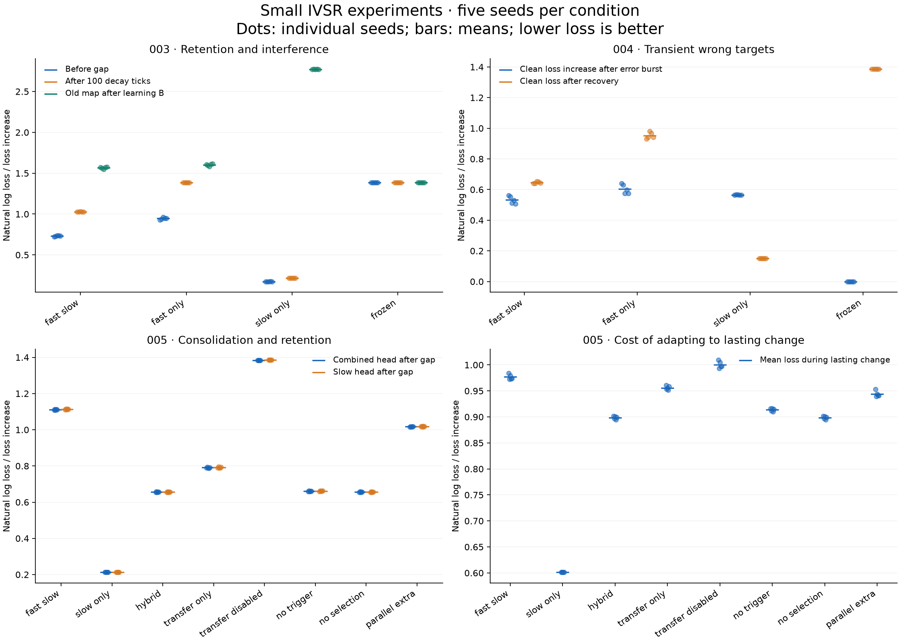

# Round 2: small IVSR experiments 003–005

[Protocol fixed before execution](../../experiments/round2_protocol.md). No tuning or extra benchmark seeds. Lower loss is better. All results concern four known categorical inputs; this is not a generalization or safety evaluation.

## Registered comparisons

| Criterion | Seeds meeting criterion |
| --- | ---: |
| 003: retention versus fast-only | 5/5 |
| 004: noise/change tradeoff versus slow-only | 0/5 |
| 005: hybrid retention gain within adaptation-cost limit | 5/5 |
| 005: useful slow learning from transfer alone | 5/5 |

A criterion is supported here only if all five seeds meet it. These comparisons have different baselines and do not establish overall superiority.



## retention: single

Means across seeds; recovery shows median among reached runs and the count reached, so censored runs remain visible.

| Model | warmup_combined_loss | gap_combined_loss | interference_old_combined_loss | return_combined_loss | return_recovery |
| --- | ---: | ---: | ---: | ---: | ---: |
| fast_slow | 0.7311 | 1.0279 | 1.5670 | 0.7038 | 69 (5/5 reached) |
| fast_only | 0.9463 | 1.3833 | 1.6036 | 0.9562 | 49 (5/5 reached) |
| slow_only | 0.1745 | 0.2162 | 2.7724 | 0.1587 | 91 (5/5 reached) |
| frozen | 1.3863 | 1.3863 | 1.3863 | 1.3863 | not reached (0/5) |
## noise: transient

Means across seeds; recovery shows median among reached runs and the count reached, so censored runs remain visible.

| Model | transient_loss_increase | tail_combined_loss | tail_recovery |
| --- | ---: | ---: | ---: |
| fast_slow | 0.5334 | 0.6456 | 42 (5/5 reached) |
| fast_only | 0.6038 | 0.9524 | 48 (5/5 reached) |
| slow_only | 0.5655 | 0.1505 | 40 (5/5 reached) |
| frozen | 0.0000 | 1.3863 | not reached (0/5) |
## noise: persistent

Means across seeds; recovery shows median among reached runs and the count reached, so censored runs remain visible.

| Model | disturbance_combined_loss | tail_training_loss | tail_combined_loss | tail_recovery |
| --- | ---: | ---: | ---: | ---: |
| fast_slow | 1.0434 | 0.8940 | 0.7825 | 91 (5/5 reached) |
| fast_only | 0.9871 | 0.9626 | 0.9551 | 40 (5/5 reached) |
| slow_only | 1.0871 | 0.3901 | 0.1834 | 58 (5/5 reached) |
| frozen | 1.3863 | 1.3863 | 1.3863 | not reached (0/5) |
## consolidation: single

Means across seeds; recovery shows median among reached runs and the count reached, so censored runs remain visible.

| Model | gap_combined_loss | gap_slow_loss | reversal_training_loss | reversal_recovery | accepted_transfers | selection_labels_accessed |
| --- | ---: | ---: | ---: | ---: | ---: | ---: |
| fast_slow | 1.1112 | 1.1133 | 0.9768 | 218 (4/5 reached) | 0.0000 | 0.0000 |
| fast_only | 1.3834 | 1.3863 | 1.0006 | 50 (5/5 reached) | 0.0000 | 0.0000 |
| slow_only | 0.2133 | 0.2133 | 0.6014 | 92 (5/5 reached) | 0.0000 | 0.0000 |
| frozen | 1.3863 | 1.3863 | 1.3863 | not reached (0/5) | 0.0000 | 0.0000 |
| hybrid | 0.6557 | 0.6563 | 0.8986 | 186 (5/5 reached) | 32.6000 | 260.8000 |
| transfer_only | 0.7907 | 0.7917 | 0.9559 | 211.5 (4/5 reached) | 34.8000 | 278.4000 |
| no_trigger | 0.6606 | 0.6612 | 0.9138 | 192 (5/5 reached) | 36.0000 | 288.0000 |
| no_selection | 0.6557 | 0.6563 | 0.8986 | 186 (5/5 reached) | 32.6000 | 0.0000 |
| transfer_disabled | 1.3834 | 1.3863 | 1.0006 | 50 (5/5 reached) | 0.0000 | 0.0000 |
| parallel_extra | 1.0168 | 1.0185 | 0.9439 | 197 (5/5 reached) | 0.0000 | 288.0000 |

## Every seed and paired criterion differences

Positive retention/transfer gains favor the tested mechanism. Positive adaptation costs and noise loss differences favor its control.

| Seed | Retention gain | Transient penalty delta | Persistent loss delta | Hybrid retention gain | Hybrid adaptation cost | Transfer-only slow gain |
| --- | ---: | ---: | ---: | ---: | ---: | ---: |
| 0 | +0.3560 | -0.0032 | +0.5020 | +0.4556 | -0.0822 | +0.5966 |
| 1 | +0.3563 | -0.0113 | +0.5039 | +0.4559 | -0.0758 | +0.5904 |
| 2 | +0.3536 | -0.0544 | +0.5001 | +0.4537 | -0.0788 | +0.5958 |
| 3 | +0.3545 | -0.0343 | +0.5072 | +0.4574 | -0.0791 | +0.5977 |
| 4 | +0.3566 | -0.0576 | +0.5063 | +0.4550 | -0.0752 | +0.5926 |

[Every per-seed metric and checkpoint accuracy](metrics.json). [Complete forecasts, states, selection records and hashes](results.json).

## Accounting and limits

```json
{
  "main_pairs": 69600,
  "reserved_selection_pairs": 14400,
  "evaluation_pairs": 2880,
  "decay_ticks": 7000,
  "extra_gradient_updates": 1440,
  "unlabelled_contexts": 2880,
  "allocated_labelled_presentations": 86880,
  "selection_labels_accessed": 5576
}
```

Maximum immediate prediction change from transfer: 2.22e-16. Total clipping events: 0.

Selection pairs are reserved equally but accessed only by triggered selectors or parallel_extra; actual use is reported above. Parallel_extra trains on every reserved pair and applies decay on those updates. It controls for using extra labels directly, but has more update/decay events. Selection labels share the current corruption; they are not a clean oracle. No-selection transfer uses no extra targets.

Transient errors are one correlated burst, not IID noise. The gap applies explicit decay without feedback; frozen evaluation applies neither. Old and new mappings conflict on the same input, so the model cannot identify both without context. Comparisons of four ablations cannot establish general mechanism necessity. Differential-probe contexts cover the full four-input domain here.

```sh
python3 experiments/round2.py
python3 experiments/plot_round2.py  # matplotlib
```
