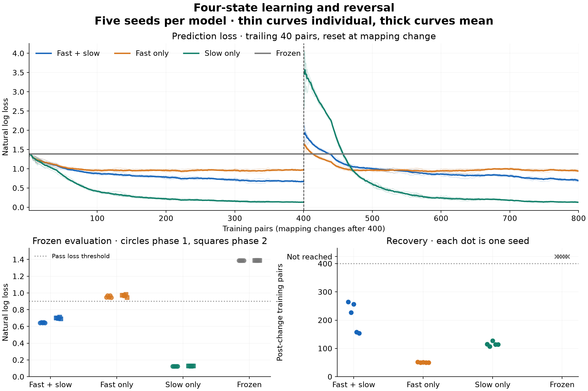

# Experiment 002: four-state learning and reversal

**Primary fast/slow result: PASS**

[Fixed protocol](../../experiments/small_reversal_protocol.md). Parameters and criteria were fixed before the run; no tuning was performed.

The target mapping changes after training pair 400. Each evaluation freezes all state and contains 25 examples of each of the four known inputs.

| Model | Phase 1 accuracy | Phase 1 loss | Phase 2 accuracy | Phase 2 loss | Median recovery trial | Seeds passing both |
| --- | ---: | ---: | ---: | ---: | ---: | ---: |
| fast_slow | 100% | 0.6458 | 100% | 0.6992 | 227 | 5/5 |
| fast_only | 100% | 0.9554 | 100% | 0.9676 | 50 | 0/5 |
| slow_only | 100% | 0.1241 | 100% | 0.1262 | 114 | 5/5 |
| frozen | 25% | 1.3863 | 25% | 1.3863 | not reached | 0/5 |

Accuracy and loss above are means across seeds. Recovery counts post-change training pairs to the first trailing-40 accuracy of at least 90%; it does not guarantee sustained recovery.



## Every seed

| Model | Seed | Phase 1 accuracy / loss | Phase 2 accuracy / loss | Phase 2 training loss | Recovery | Pass |
| --- | ---: | ---: | ---: | ---: | ---: | --- |
| fast_slow | 0 | 100% / 0.6432 | 100% / 0.6994 | 0.9030 | 265 | yes |
| fast_slow | 1 | 100% / 0.6491 | 100% / 0.7025 | 0.8996 | 227 | yes |
| fast_slow | 2 | 100% / 0.6432 | 100% / 0.6934 | 0.9000 | 256 | yes |
| fast_slow | 3 | 100% / 0.6511 | 100% / 0.7114 | 0.8989 | 158 | yes |
| fast_slow | 4 | 100% / 0.6424 | 100% / 0.6892 | 0.9007 | 154 | yes |
| fast_only | 0 | 100% / 0.9478 | 100% / 0.9711 | 0.9852 | 52 | no |
| fast_only | 1 | 100% / 0.9676 | 100% / 0.9728 | 0.9791 | 50 | no |
| fast_only | 2 | 100% / 0.9472 | 100% / 0.9665 | 0.9812 | 51 | no |
| fast_only | 3 | 100% / 0.9696 | 100% / 0.9844 | 0.9802 | 50 | no |
| fast_only | 4 | 100% / 0.9447 | 100% / 0.9435 | 0.9831 | 50 | no |
| slow_only | 0 | 100% / 0.1241 | 100% / 0.1260 | 0.4916 | 115 | yes |
| slow_only | 1 | 100% / 0.1244 | 100% / 0.1266 | 0.4920 | 107 | yes |
| slow_only | 2 | 100% / 0.1240 | 100% / 0.1257 | 0.4912 | 127 | yes |
| slow_only | 3 | 100% / 0.1238 | 100% / 0.1267 | 0.4911 | 114 | yes |
| slow_only | 4 | 100% / 0.1244 | 100% / 0.1260 | 0.4915 | 114 | yes |
| frozen | 0 | 25% / 1.3863 | 25% / 1.3863 | 1.3863 | not reached | no |
| frozen | 1 | 25% / 1.3863 | 25% / 1.3863 | 1.3863 | not reached | no |
| frozen | 2 | 25% / 1.3863 | 25% / 1.3863 | 1.3863 | not reached | no |
| frozen | 3 | 25% / 1.3863 | 25% / 1.3863 | 1.3863 | not reached | no |
| frozen | 4 | 25% / 1.3863 | 25% / 1.3863 | 1.3863 | not reached | no |

## Paired comparisons

Differences are fast/slow minus control on the same seed and data. Negative loss differences favor fast/slow. Negative recovery differences mean earlier threshold crossing.

| Control | Seed | Phase 2 evaluation loss difference | Phase 2 training loss difference | Recovery difference |
| --- | ---: | ---: | ---: | ---: |
| fast_only | 0 | -0.2717 | -0.0822 | 213 |
| slow_only | 0 | +0.5734 | +0.4113 | 150 |
| fast_only | 1 | -0.2703 | -0.0795 | 177 |
| slow_only | 1 | +0.5758 | +0.4076 | 120 |
| fast_only | 2 | -0.2730 | -0.0812 | 205 |
| slow_only | 2 | +0.5677 | +0.4088 | 129 |
| fast_only | 3 | -0.2730 | -0.0813 | 108 |
| slow_only | 3 | +0.5847 | +0.4078 | 44 |
| fast_only | 4 | -0.2542 | -0.0824 | 104 |
| slow_only | 4 | +0.5632 | +0.4092 | 40 |

## Checks and limits

All probabilities were finite and normalized, and all weights remained within bounds. Total clipping events: 0. Evaluation preserved all weights and counters.

Exactly 20,000 presentations: 16,000 training presentations (12,000 update events and 4,000 frozen-control presentations), plus 4,000 evaluation presentations.

Passing requires at least 90% accuracy and loss below 0.9 in both frozen evaluations for every fast/slow seed. Uniform baseline loss is log(4), about 1.3863.

This tests four categorical associations and relearning after a mapping change. The one-hot input representation and all output categories are constructed. It does not test compositional use of both/neither, unseen-input generalization, evolving distinctions, phase coordination, consolidation, interpretability, steering, or safety. Both timescales learn directly from external targets.

The controls match the initial effective step and possible weight range, but are not tuned; the dual model stores twice as many parameters. Five seeds on one deterministic task do not establish general superiority. Frozen evaluations do not test long-term retention under continued decay.

## Reproduce

```sh
python3 experiments/small_reversal.py
python3 experiments/plot_small_reversal.py  # requires matplotlib
```

[Complete data](results.json) include the protocol and implementation SHA-256 hashes, mappings, parameters, every forecast and target, weight trajectories, and evaluations.
