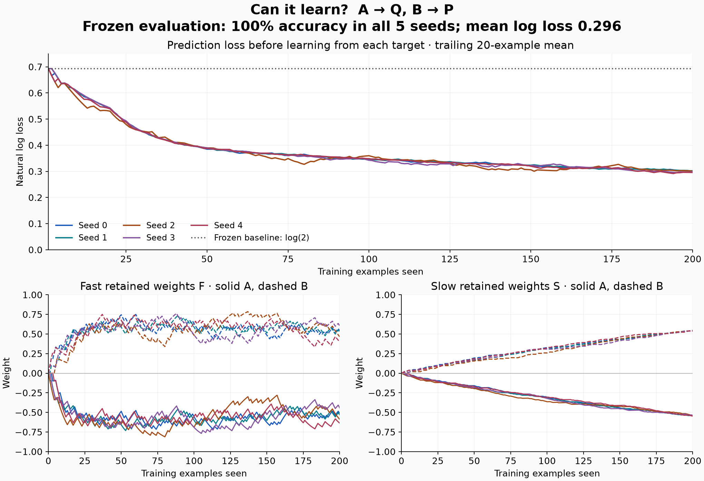

# Experiment 001: can the fast/slow learner learn a mapping?

**Result: PASS**

The fixed protocol is [protocol.md](../../experiments/tiny_mapping_protocol.md). No hyperparameter search or changes to the pass criteria were performed.

| Seed | Evaluation accuracy | Mean log loss | P(P given A) | P(P given B) | Pass |
| --- | ---: | ---: | ---: | ---: | --- |
| 0 | 100% | 0.294511 | 0.257796 | 0.747596 | yes |
| 1 | 100% | 0.294481 | 0.254402 | 0.744239 | yes |
| 2 | 100% | 0.296744 | 0.244613 | 0.731277 | yes |
| 3 | 100% | 0.297162 | 0.272833 | 0.759021 | yes |
| 4 | 100% | 0.298727 | 0.234135 | 0.718418 | yes |

The frozen zero-weight control has 50% accuracy and log loss 0.693147 on every balanced evaluation set. Ties predict P.

The trained model's mean evaluation log loss across seeds is 0.296325. Passing requires at least 90% accuracy and log loss strictly below 0.5 on each seed.

Each run has 200 training pairs and 40 evaluation pairs. There are 1,000 learning updates total, plus 200 read-only evaluations for each model condition. Evaluation weights remain frozen. Inputs are one-hot cues, and each target is revealed only after its forecast.



The upper panel shows loss before each target-driven update, smoothed over the most recent 20 examples. The lower panels show separate fast and slow weights. All five seeds are shown; smoothing is for display only.

## Interpretation and limits

This tests acquisition and retention during frozen evaluation of a two-cue deterministic mapping. Evaluation repeats the same two input types; it does not test generalization to unseen inputs. The model and two input features are constructed; the mapping is supplied only in the external targets. No architecture search was performed.

This experiment does not establish an advantage over a single-rate learner, fast-to-slow consolidation, delayed credit assignment, phase coordination, or learning new distinctions. It also does not test retention during a long period of continued decay without feedback.

## Reproduce

```sh
python3 experiments/tiny_mapping.py
python3 experiments/plot_tiny_mapping.py  # requires matplotlib
```

[Complete predictions, weights, parameters, and metrics](results.json).
