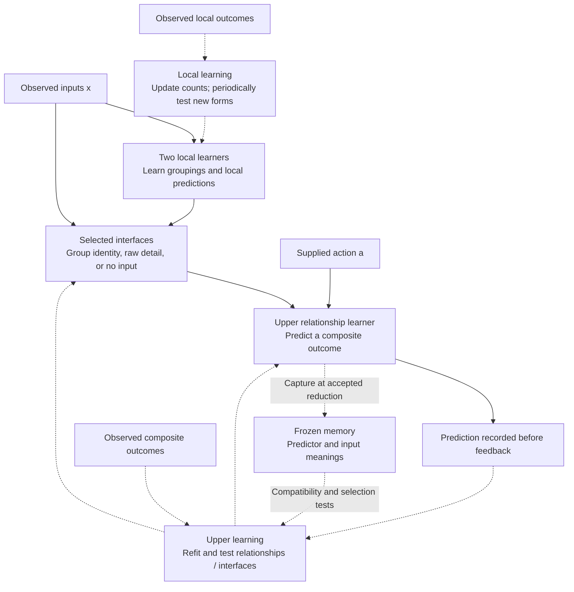
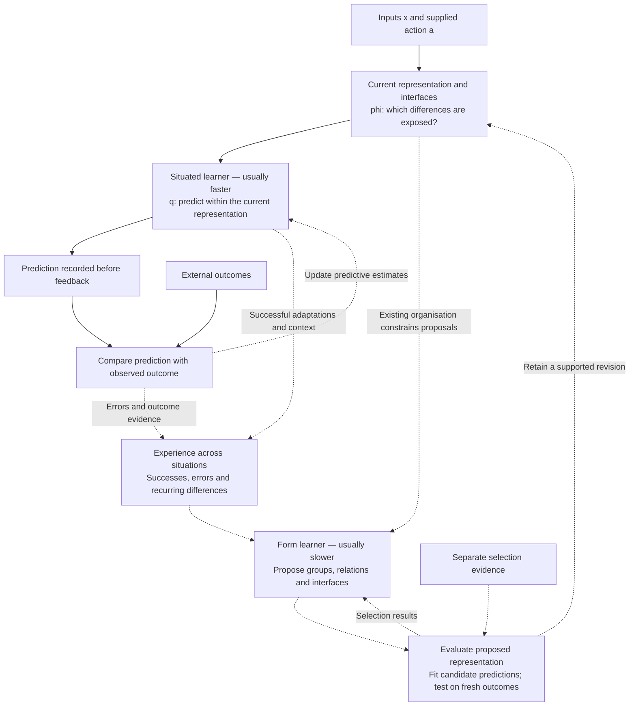

# Current and proposed learning dynamics

Diagram notes, 2026-10-27. The first diagram shows the consolidated reference
learner. Protection and memory-selection alternatives remain separate
experiments. The second is a proposed division of labour, not an implemented
or tested architecture. Solid arrows show observations and predictions;
dashed arrows show learning, structural change or memory operations.

## Current: prediction and structural learning within modules

There are two local learners and an upper learner, rather than a distinct
fast predictor paired with a slow representation learner. Each level combines
predictive and structural operations. Local groupings can be revised or
collapsed; upper inputs can be selected, exposed in detail or hidden. Raw
upper predictors refit during observation; group-only upper tables can remain
fixed between accepted changes. Frozen archives do not learn while stored.

The local and composite outcome channels are supplied separately. Candidate
fitting uses main observations; acceptance uses separate selection evidence.
The direct input-to-interface path represents available raw access, not an
unrestricted bypass. The selected interface governs what the upper predictor
can read.

## Proposed: situated prediction and reusable form learning

The situated learner primarily changes predictions, q. The form learner
primarily changes the representation, phi, using both successful adaptation
and failure as evidence. Proposed representations need compatible predictive
models before comparison; old parameters cannot simply be assumed to retain
their meanings after a structural change.

Faster and slower describe intended roles, not mandatory rates. A new distinction
might need rapid discovery followed by slower consolidation. External evidence
remains essential, and structural search must remain possible even when
existing predictors agree. This proposed separation is not yet meta-learning:
the rules governing both roles would initially remain supplied.
